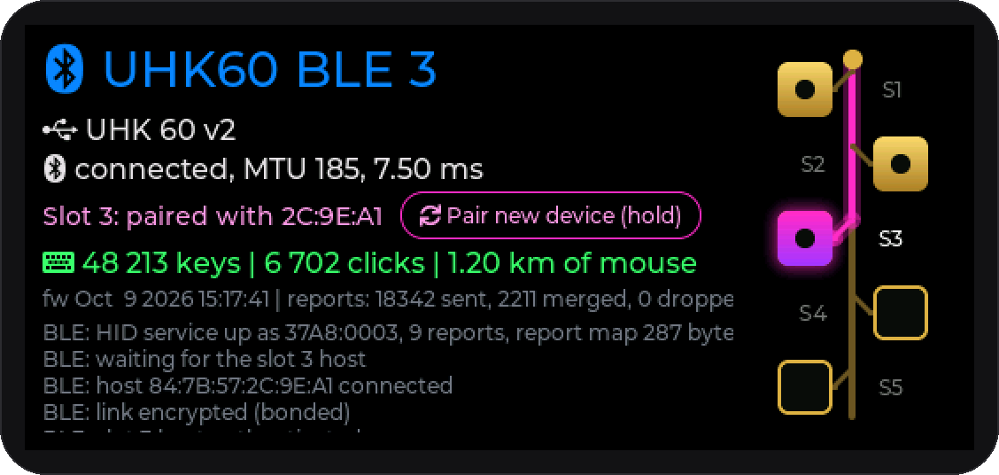
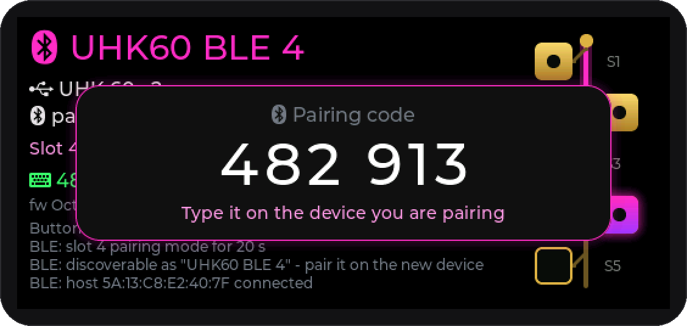
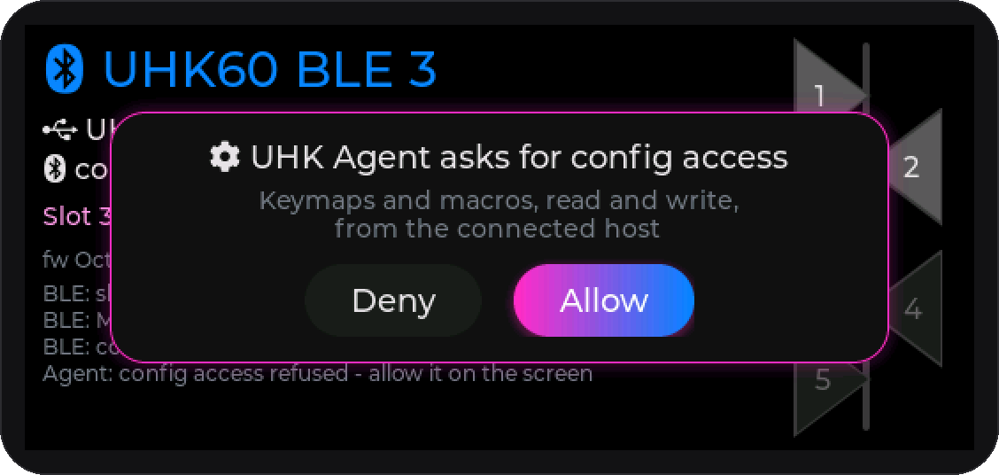
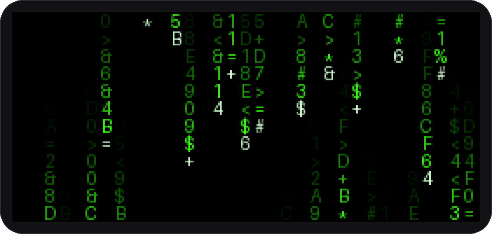
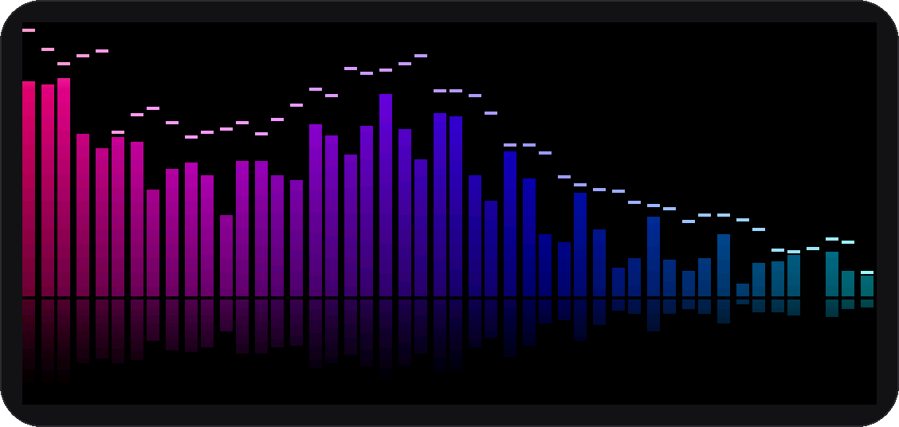
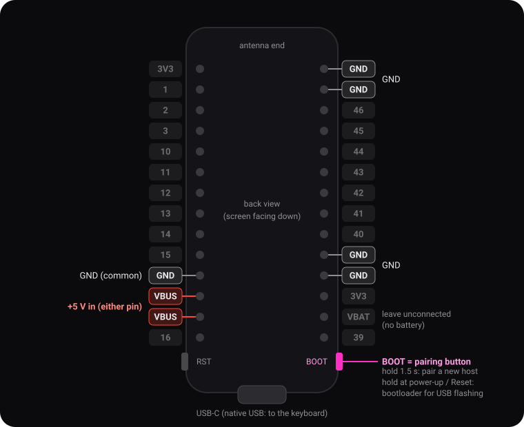
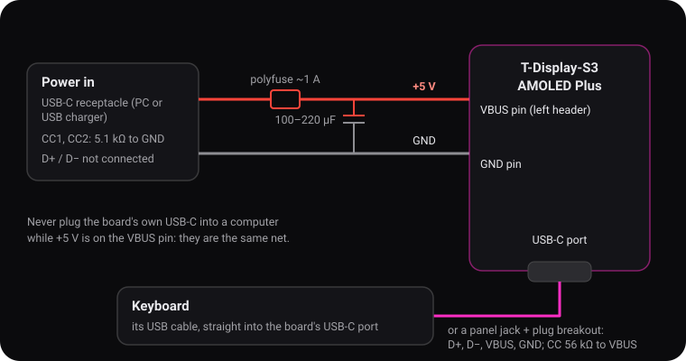

# UHK 60 v2 → BLE adapter

A DIY USB→Bluetooth adapter for the Ultimate Hacking Keyboard 60 v2, built on a
LilyGo T-Display-S3 AMOLED Plus. Hardware and firmware details are in
[CLAUDE.md](CLAUDE.md).

<p align="center">
  
</p>

## What it does

- **Up to 5 Bluetooth hosts.** Every slot is a Bluetooth device of its own
  ("UHK60 BLE 1" … "UHK60 BLE 5") with its own address. Each computer, tablet
  or phone pairs with its own slot and reconnects to it by itself. To move the
  keyboard to another host, tap its pad on the little circuit board on the
  right of the screen.
- **UHK Agent over Bluetooth.** The adapter passes the keyboard's Agent
  command channel through as a separate Bluetooth HID device that identifies
  as a UHK 60 v2. Agent finds the keyboard and reads and writes its keymaps
  and macros without a cable. As far as we can tell from Agent's sources, it
  configures even the Bluetooth-capable UHK 80 only over USB. Keyboard
  firmware updates still need the cable.
- **Simple hardware.** The board, a 5 V supply on its VBUS pin and the
  keyboard in its USB-C port: the board is the keyboard's USB host and a
  Bluetooth keyboard and mouse for the computer. See [Build](#build).
- **Everything the keyboard sends, unchanged.** The Bluetooth HID layout is
  built from the keyboard's own USB descriptors: NKRO, mouse keys with smooth
  scrolling, media and system keys. Keystrokes are never merged, so fast
  macros arrive intact.
- **Typing statistics.** The screen counts your key presses, mouse clicks and
  how far the mouse pointer travelled. The totals survive restarts: they are
  saved hourly, when the screen goes dark and before updates.
- **Secure by default.** Pairing needs the 6-digit code shown on the
  adapter's screen, and only the active slot's host gets keystrokes. Agent can
  read status freely; reading or changing the configuration needs a tap on
  **Allow** on the adapter.
- **Wireless updates of the adapter.** New firmware goes over Bluetooth into
  the second app slot while the keyboard keeps typing. If the new firmware
  fails before a host reconnects, the adapter rolls back to the previous one.
- **Standby animation and live audio spectrum.** When idle, the screen plays
  an animation uploaded from the PC (no reboot). Or it shows the spectrum of
  whatever the PC is playing, streamed live. Their brightness follows the time
  of day. See [Screen animations](#screen-animations).

<table>
  <tr>
    <td></td>
    <td></td>
  </tr>
  <tr>
    <td align="center">Pairing a new host: type the code on it</td>
    <td align="center">UHK Agent asks before touching the config</td>
  </tr>
</table>

## Screen animations

<table>
  <tr>
    <td></td>
    <td></td>
  </tr>
  <tr>
    <td align="center">Standby animation (the built-in <code>matrix</code> demo)</td>
    <td align="center">Live spectrum of the PC's audio</td>
  </tr>
</table>

Both are controlled from the PC that is paired on the active slot, over the same
encrypted Bluetooth link as the keyboard. The tools run on **Windows** for now
(see [Linux and macOS](#linux-and-macos)) and need Python with
`pip install bleak numpy pillow`, plus `soundcard` for the live spectrum.

### Standby animation

```bash
python tools/ble_anim.py upload demo:matrix   # or a .gif / .webp, a folder of PNGs, a .uanm file
python tools/ble_anim.py play                 # show it now (also: stop)
python tools/ble_anim.py info                 # what is stored, settings, the adapter's clock
```

- The animation is stored on the adapter (up to 3.4 MB) and plays after 60 s
  without a touch. A touch or the BOOT button brings the normal screen back;
  typing on the keyboard does not stop it. After 30 minutes of animation the
  screen goes dark (AMOLED burn-in).
- Uploading takes a few seconds (~45 KB/s, the matrix demo is 610 KB). The
  adapter does not reboot, and the keyboard keeps typing.
- Pictures are fitted to the 536 × 240 screen. `--scale 2` (the default)
  stores half resolution and doubles the pixels: 4× less data. Try
  `make` and `preview` first: they build the file and a GIF that shows exactly
  what the adapter will play.
- Settings (unset options keep their value):
  `python tools/ble_anim.py set --delay 120 --off-after 3600 --mode off`.

### Live spectrum

```bash
python tools/ble_live.py --agc
```

- Captures what the PC plays (WASAPI loopback), runs the FFT on the PC and
  sends only the band levels: about 50 bytes per frame, 60 frames/s. The
  adapter draws the bars, the falling peak caps and the reflection itself, so
  the keyboard's traffic is not affected.
- Audio-to-screen delay is roughly 40–70 ms (estimated: capture, FFT window,
  Bluetooth, drawing).
- The spectrum appears as soon as the stream starts and disappears 1.5 s after
  it stops (Ctrl-C). A touch shows the normal screen; the spectrum comes back
  after 30 s.
- `--agc` adjusts the gain slowly, so quiet music still fills the bars.
  `--bands 8..64`, `--device <speaker>` (list them with `--list`),
  `--test` (a sweep, no audio needed), `--brightness N` (fixed instead of by
  the time of day).

### Brightness by the time of day

The animation and the spectrum are dimmer at night and brighter by day:

| Time | 22:00–6:00 | 7:00 | 8:00 | 9:00–18:00 | 19:00 | 20:00 | 21:00 |
|---|---|---|---|---|---|---|---|
| Brightness (of 255) | 30 | 56 | 128 | 180 | 147 | 88 | 45 |

```bash
python tools/ble_anim.py set --brightness 200 --night 20   # day / night levels
```

The adapter's clock is the board's RTC, which has a rechargeable backup cell.
Every connection of the tools sets it to the PC's local time. Until it has
been set, the day level is used.

### Linux and macOS

The tools use Windows' own Bluetooth connection to the paired adapter (WinRT,
via the projections that `bleak` installs). The adapter does not advertise
while its host is connected, so there is nothing to scan for. Porting would
mean:
- **Bluetooth:** Linux (BlueZ) lets an app use the GATT services of a device
  the system is already connected to, so `bleak` can do it there. macOS needs
  CoreBluetooth's `retrieveConnectedPeripheralsWithServices`, which `bleak`
  does not expose.
- **Audio capture:** `soundcard` records the output's monitor source on Linux
  (PulseAudio / PipeWire). macOS has no loopback; a virtual device such as
  BlackHole is needed.

## Build

The adapter is the board and a 5 V supply: **+5 V on the board's VBUS pin**,
and the keyboard plugged into its USB-C port. That port's VBUS is the same net
as the VBUS pin, so the keyboard gets its power from there. Step-by-step
instructions and a parts list are on the
[project page](https://a1ext.github.io/uhk-ble-adapter/#build).

<p align="center">
  
</p>

| Pin (back view, USB-C at the bottom) | Connect to |
|---|---|
| **VBUS** (left header, either of the two) | +5 V, through a ~1 A polyfuse |
| **GND** | ground of the 5 V supply |
| **USB-C port** | the keyboard: its cable directly, or a panel jack through a USB-C plug breakout |
| **BOOT** button | nothing to wire: the pairing button (hold 1.5 s); held at power-up it starts the bootloader |

<p align="center">
  
</p>

- On a USB-C power jack, connect a 5.1 kΩ resistor from CC1 to GND and another
  from CC2 to GND, so chargers and USB-C to USB-C cables supply 5 V. Put
  100–220 µF across +5 V and GND close to the board.
- A panel USB-C jack for the keyboard: D+, D−, VBUS and GND straight to a USB-C
  plug breakout in the board's port, a 56 kΩ resistor from CC1 to VBUS and
  another from CC2 to VBUS, and A6 joined with B6 (D+), A7 with B7 (D−).
- **Never plug the board's USB-C into a computer while +5 V is on the VBUS
  pin:** that connects two 5 V supplies to each other. Disconnect the supply
  and the keyboard before flashing by cable.
- The UHK asks for up to 500 mA, and the board adds 100–250 mA: use a USB 3
  port (900 mA) or a charger.

## Flashing

The adapter's screen shows which firmware is running: the line above the log
starts with `fw <build date> <build time>`.

### Fresh board: web installer

**<https://a1ext.github.io/uhk-ble-adapter/>** flashes the firmware straight
from the browser. You don't need to install any tools.

You need:
- a LilyGo T-Display-S3 AMOLED Plus and a USB-C cable that carries data (some
  charging cables don't);
- Chrome, Edge or Opera on a desktop computer (Windows, macOS, Linux). The page
  talks to the board over Web Serial, which Firefox, Safari and mobile browsers
  don't support.

Steps:
1. Disconnect the 5 V supply and the keyboard, then plug the board's USB-C
   straight into the computer, without a hub if you can.
2. Open the page and click **Install firmware**.
3. Pick the board's port. It's usually called "USB JTAG/serial debug unit"
   (a COM port on Windows, `/dev/cu.usbmodem…` on macOS).
4. Tick **Erase device** on the first install and confirm. Flashing takes
   about a minute.
5. When the installer reports success, press **Reset** once if the screen
   stays black. The installer's own reset can leave the chip in its
   bootloader.

Then set it up:
1. Wire the 5 V supply (see [Build](#build)) and plug the keyboard into the
   board's USB-C port. The adapter reads the keyboard's layout once and
   remembers it.
2. Pick a slot (tap its pad on the right), then hold **BOOT** for 1.5 s, until
   the bar along the bottom edge fills.
3. Within 20 s, add **UHK60 BLE n** on the computer or phone, and type the
   6-digit code that the adapter shows.

If something goes wrong:
- **No port in the list:** the firmware is already running and uses the USB
  port as the keyboard's USB host. Put the board into its bootloader: hold
  **BOOT**, press and release **Reset**, release **BOOT**, then click
  **Install firmware** again. Press **Reset** after flashing.
- **"Failed to open serial port":** another program is using the port. Close
  serial monitors, PlatformIO and other installer tabs.
- **The adapter is assembled** and its USB-C is wired to the keyboard: the
  browser can't reach the board. Update it over Bluetooth (below).

Reinstalling later works the same way. Untick **Erase device** to keep the
paired hosts and the cached keyboard layout. For routine updates, use
Bluetooth (below).

The page always installs the latest build of `master`; its version is shown
next to the button. Fixed versions are on the
[Releases page](https://github.com/a1ext/uhk-ble-adapter/releases):
`*-full.bin` is the complete image, written at 0x0 with any esptool
(`esptool.py --chip esp32s3 write_flash 0x0 uhk-ble-adapter-v1.0-full.bin`).
`*-ota.bin` is the app image for the Bluetooth uploader.

Maintainers: CI (`.github/workflows/build.yml`) builds the site from `docs/`
plus the firmware on every push to `master` and deploys it to GitHub Pages
(**Settings → Pages → Source: GitHub Actions**). Version tags (`v*`) also
create a release. For tags to deploy too, allow `v*` under **Settings →
Environments → github-pages**.

The screenshots in `docs/img` are rendered from the real UI code (`src/ui.cpp`
with LVGL and `src/live.cpp`, on a PC; the matrix frame goes through the same
encoder and decoder as an upload) after UI changes, not in CI:

```bash
python tools/ui_sim/render.py
```

It needs gcc / g++ on PATH (on Windows e.g. TDM-GCC or MSYS2 MinGW), Pillow and
numpy (`pip install pillow numpy`) and LVGL from PlatformIO (`pio run` once). The scenes
and their canned data are in `tools/ui_sim/sim.cpp`.

### Over Bluetooth (OTA, from Windows) — the usual way

No cables: the new image is written to the second app slot while the adapter
keeps running, so the keyboard keeps typing.

Requirements:
- the adapter is paired with this PC and connected to it;
- a Python with the WinRT Bluetooth bindings: `pip install bleak`. To use a
  different interpreter, point the `UHK_OTA_PYTHON` environment variable at it.

```bash
pio run -t ota
```

The same without the PlatformIO target:

```bash
python tools/ble_ota.py .pio/build/t-display-s3-amoled-plus/firmware.bin
```

What happens:
1. The firmware is built, then the adapter erases the second slot (a few seconds).
2. Sending ~1.4 MB takes about 35 s (~43 KB/s). The adapter's screen shows the
   progress: a bar along the bottom edge and a "Firmware update N%" line.
3. The adapter verifies the image (SHA-256 and format) and reboots into the new
   firmware; the keyboard is back within a few seconds.
4. The new firmware is confirmed once Windows has reconnected (the log shows
   `OTA: new firmware confirmed`) or after 5 minutes of uptime. If it crashes or
   resets before that, the bootloader brings the previous firmware back.

Only the host paired on the active slot can flash the adapter over Bluetooth:
OTA requires its passkey-authenticated, encrypted connection.

### Over USB

```bash
pio run -t upload
```

- Disconnect the 5 V supply and the keyboard, and plug the board's USB-C into
  the PC.
- The running firmware uses that port as the keyboard's USB host, so there is
  no COM port: enter the bootloader first. Hold BOOT while you plug the cable
  in (or hold BOOT, press Reset, release BOOT). A fresh board shows the port
  right away.
- The board restarts by itself after flashing.

### Troubleshooting

- **"OTA service not found"** — the adapter runs firmware without OTA (flash it
  over USB the first time), or Windows cached an old service list: remove the
  adapter in the Windows Bluetooth settings and pair it again.
- **"OTA characteristic … not found" right after another tool** — Windows
  keeps the service busy for a while after a tool was killed instead of
  stopped with Ctrl-C. Wait ~20 s and run it again.
- **"no paired device named 'UHK60 BLE*'"** — the adapter is not paired: hold
  BOOT for 1.5 s (bar along the bottom of the screen), then
  add the device in Windows within 20 s and type the 6-digit code the adapter
  shows.
- **"OTA service not found (status 1)"** with "not connected" — Windows has no
  link to the adapter right now: select the slot of this PC and check that the
  keyboard types on it.
- **After a firmware update all hosts must pair again** when the release notes
  say so (pairing format changes): remove "UHK60 BLE n" on the host, then pair
  it again as above.
- **Windows does not see any Bluetooth devices** — on the development PC the
  Intel Bluetooth driver had stopped receiving advertisements; the driver
  installer from the ASUS site fixed it.
- **UHK Agent says it cannot read / write the configuration** — over Bluetooth
  the adapter only lets status commands through by default. Tap **Allow** in
  the "UHK Agent asks for config access" pop-up on the adapter's screen, then
  retry in Agent; access stays open for 10 minutes after the last change and
  closes when the host disconnects ("Agent open … - tap to lock" closes it now).
- **The UHK keyboard's own firmware** cannot be updated over Bluetooth: the
  adapter refuses those Agent commands. Plug the keyboard straight into the
  PC to update it.
